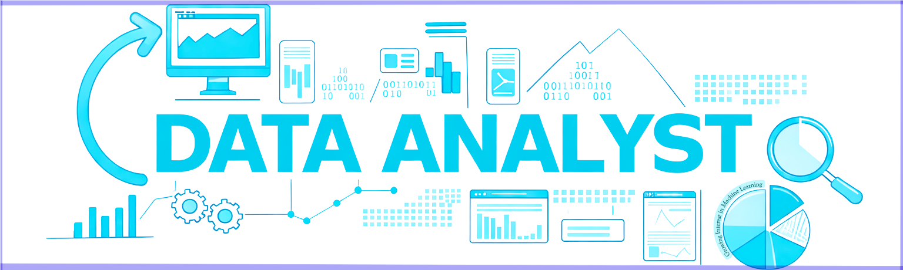

<!-- 

  

 -->

<h1 align="center">Hi 👋, I'm Sanchal</h1>

<h3 align="center">
Machine Learning • Deep Learning • AI Applications
</h3>

A Computer Science undergraduate building deep learning systems, with a strong foundation in Python, SQL, and Statistics. I handle the entire pipeline for ML/DL projects, from curating specialized datasets and training models to deploying them as working applications.

> Passionate about building projects that solve real-world problems and documenting the learning process through GitHub.

---

## Current Journey
- ✅ Python Programming
- ✅ Statistics for Data Science and Analytics
- ✅ Excel (Advanced: Dashboards, KPIs, Pivot Tables)
- ✅ Advanced SQL for Data Extraction and Analysis
- ✅ Machine Learning and Deep Learning
- 🔄 LLMs, RAG, and Agentic AI
- ⏳ BI Tools

---

## What I Work Upon

- Building **deep learning** models for computer vision using **TensorFlow and Keras**, from CNNs trained from scratch to fine-tuned transfer learning models like MobileNetV2.
- Deploying trained models as live applications with **Streamlit**, such as plant species identification (**86.09%** validation accuracy) and crop disease detection (**98%+** test accuracy on four crops).
- Debugging why models fail on real-world data, and fixing the data pipeline instead of just tuning the model.
- Building anomaly detection systems for time-series sensor data, combining **LSTM autoencoders** with rule-based validation layers.
- Analyzing real-world datasets with **Excel, SQL, and Python** through data cleaning, exploratory data analysis (EDA), and KPI dashboards that turn raw data into clear business insight.

## Featured Projects

- **[CaliPlant AI](https://github.com/Sanchal-01/CaliPlant_AI)**: identifies 51 California plant species from a single photo. Built solo over five iterations, from a model that barely learned to **86.09%** validation accuracy using a fine-tuned MobileNetV2. `Python` `TensorFlow` `Keras` `Streamlit`
- **[KrishiNetra AI](https://github.com/Sanchal-01/KrishiNetra-AI)**: plant disease detection across five crops using crop-specific CNNs, deployed live with Streamlit. Four crops reach **98%+** test accuracy. Built with a teammate. `Python` `TensorFlow` `Keras` `Streamlit`
- **[SkyGuard AI](https://github.com/RanuGaurav05/skyguard-ai)**: multi-layer anomaly detection for automatic weather station data, built for Smart India Hackathon. I co-built the AI/ML core: a physics rule engine, an LSTM autoencoder, and a rolling-std stuck-sensor check that lifted recall on frozen sensors from 3% to **67.1%**. Team project, still in progress. `Python` `TensorFlow` `Keras` `Scikit-learn`
- **[ClarificAI](https://github.com/Sanchal-01/LLM-Based-AI-Agent)**: RAG-powered PDF assistant that answers questions grounded in your own document, using FAISS vector search and the Gemini LLM. `Python` `RAG` `FAISS` `Gemini`

## More Projects

- **[Retail Sales Dashboard](https://github.com/Sanchal-01/Excel-data-analytics-projects)**: interactive Excel dashboard on 10,000+ rows of retail data, covering KPIs, pivot tables, and slicers. `Excel` `Pivot Tables`
- **[Statistics for Data Analytics and Data Science](https://github.com/Sanchal-01/Statistics-for-Data-Analytics-and-Data-Science)**: self-made notes on core statistics concepts for analytics and data science. `Statistics`
- **[Local Host Survival](https://github.com/Sanchal-01/local-host-survival)**: offline-first communication portal built with Flask and WebSockets to restore local connectivity without internet. `Python` `Flask` `WebSockets`

## Socials

## Tech Stack
      
      
   

---

## Fun Fact
> Every project on this profile represents something I genuinely wanted to understand, not just another tutorial I followed.

## Looking to Collaborate On
> Open-source projects in **Machine Learning, Computer Vision, and AI Applications**.
> I'm always open to learning, collaborating, and connecting with fellow developers and data enthusiasts.

> Thanks for stopping by! Feel free to explore my repositories, and if you find something useful, don't forget to leave a ⭐.
